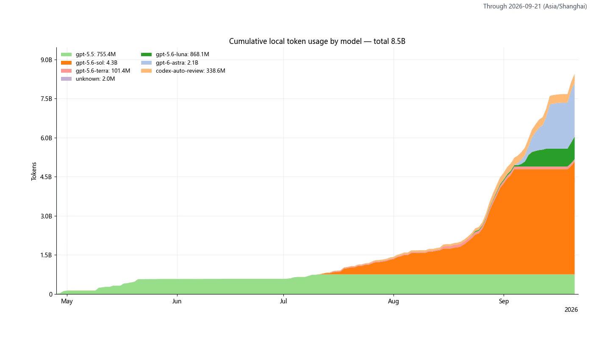
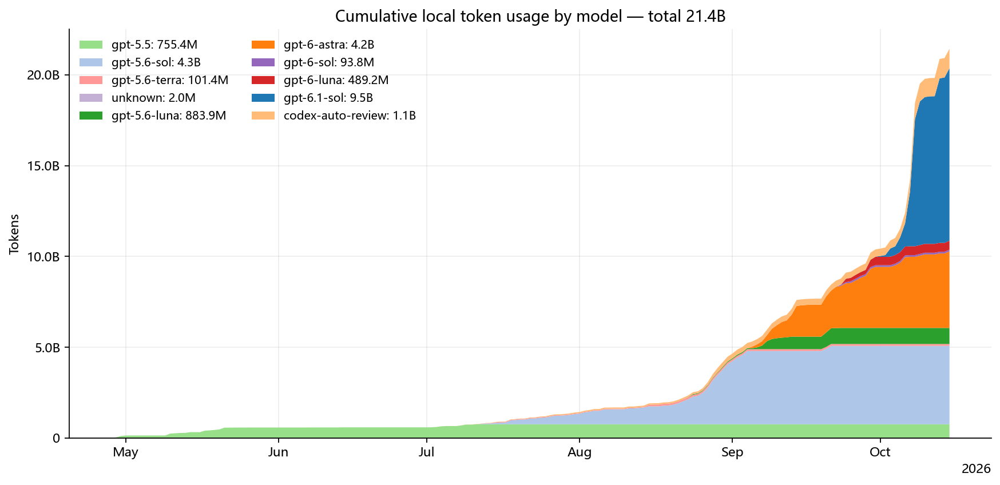
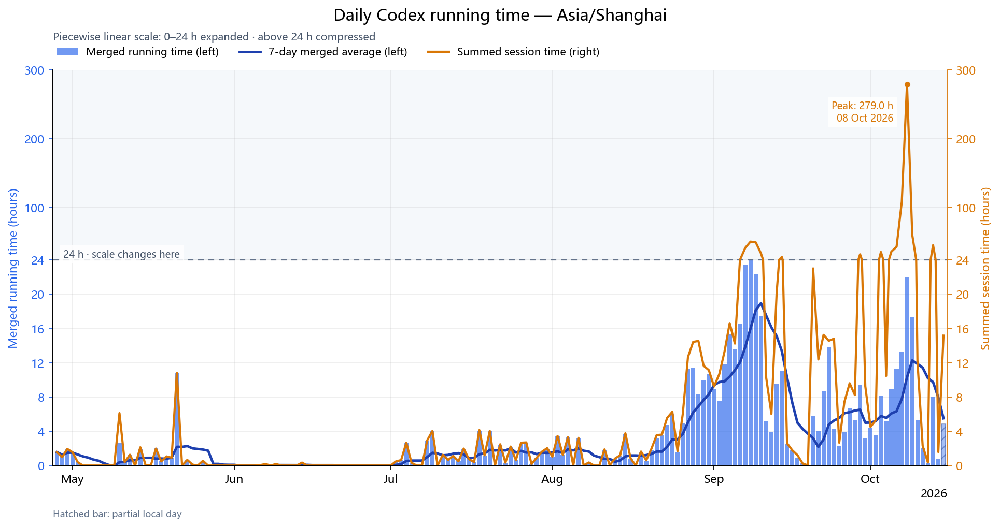

# Codex 本地用量统计

从本机 Codex 日志生成用量图片：token、运行时间、缓存未命中率、模型分布和 API 费用估算，包含按 token 类型拆分的每日费用。



[查看或下载 MP4 版本](codex_usage_report/02_cumulative_tokens.mp4)。动画按日推进，坐标轴随当时数据缩放，模型颜色始终一致，末尾额外停留一秒。

<details>
<summary>查看累计用量静态图片</summary>



</details>



图片和动画来自作者的真实本地日志。

统计范围是本机仍保留的日志，不代表账户额度。费用按项目记录的 API 单价估算，不是实际账单。工具在本地运行，无需 API key。

## 使用

安装后运行 `codex-usage gui`，点击「更新图片」。首次完整读取，之后增量读取；完成后点击「打开图片文件夹」。Windows 也可以为该命令创建快捷方式。

图片和 CSV / JSON 数据文件默认保存在工具用户状态目录的 `reports/`；运行 `codex-usage paths` 查看实际路径。GUI 默认读取 `CODEX_HOME` 或用户目录下的 `.codex`，使用上海时区，包含归档记录。需要调整时展开「设置」。

每次更新默认额外生成图 2 的 MP4 动画，从 30 天前推进到今天，模型颜色保持一致。其他图片的动画按需生成，可以直接让 AI agent 按图片编号操作，见 [动画用法](docs/usage.md#动画)。

更多操作见 [使用指南](docs/usage.md)，文件清单见 [输出文件参考](docs/reference.md)。

其他项目可通过 `codex-usage query` 按会话、回合和模型取得 JSON / CSV，用于子代理或实验记账，默认只返回数据。命令与 Python 示例见 [供其他项目调用](docs/integration.md)。

## 安装

0.2.0 使用普通 Python wheel 安装，发行名为 `codex-usage-plot`，需要 Python 3.10+。基础安装只用标准库；查询需安装 `data` extra，图片和 GUI 需 `plotting` extra。GUI 还需 Tcl/Tk；MP4 动画需自行安装 FFmpeg 并加入 PATH，或设置 `CODEX_USAGE_FFMPEG_EXE`。

取得 wheel 后，使用日常运行工具的同一个 Python 安装，例如：

```sh
python -m pip install "/path/to/codex_usage_plot-0.2.0-py3-none-any.whl[plotting]"
codex-usage setup --gui
codex-usage paths
```

`codex-usage` 与 `python -m codex_usage` 等价，可从任意工作目录运行；无需保留源码，也不依赖其他工具。启动时只检查环境，不创建虚拟环境或自动安装依赖。也可以将 wheel 路径与下面这段话一起交给 AI agent：

```text
请用我选定的同一个 Python，通过 python -m pip install 轻装我提供的 wheel，先不加 extra。
先看 python -m codex_usage --help；查询用 setup --install data，图片或 GUI 用 setup --install plotting，均通过同一个 Python 的 -m codex_usage 显式执行。
按用途检查 Tkinter 和已有外部 FFmpeg；缺失时说明需要安装或配置什么。
状态和报告根目录已有明确选择就直接使用，否则先询问；用 setup --state-dir / --report-dir 保存，并保留旧设置、缓存和结果，明确迁移路径。
用合成 demo 验证所选图片功能，不读取我的真实日志、不自动打开 GUI。
完成后交代 Python、安装版本、目录、手动启动方式和实际验证结果及余项。
```

具体步骤及旧版迁移见 [安装指南](docs/installation.md)。安装依赖需要网络，日常生成图片在本地完成。

## 数据

工具只读取会话元数据和用量、活动时间，不使用或导出对话正文，不修改原始日志。完整数据文件可能包含任务标题、工作目录和会话 ID，分享前请检查。

## 文档

- [常见问题](docs/troubleshooting.md)
- [API 费用估算](docs/api-cost.md)
- [开发文档](dev_doc/README.md)
- [参与贡献](CONTRIBUTING.md)
