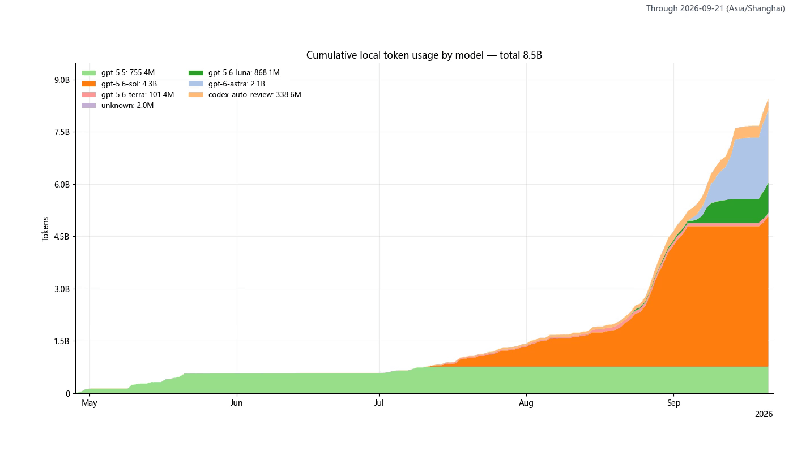
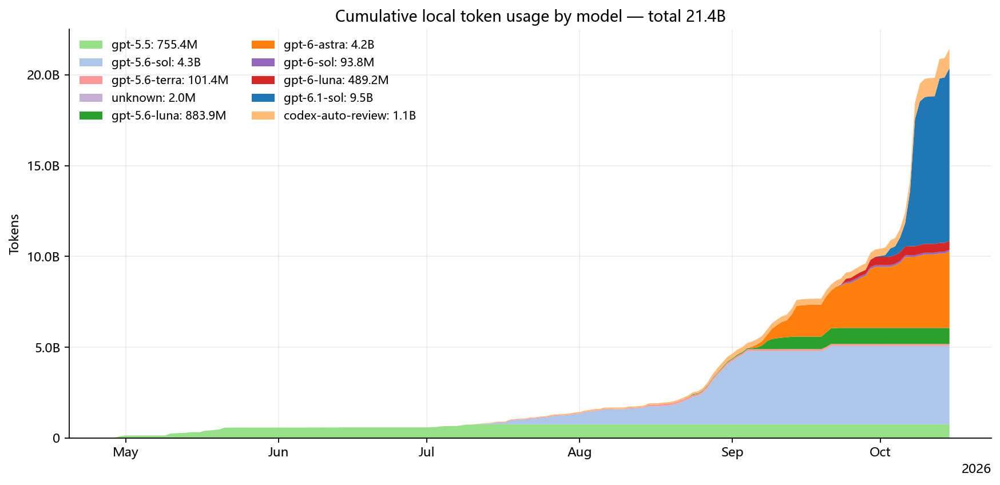
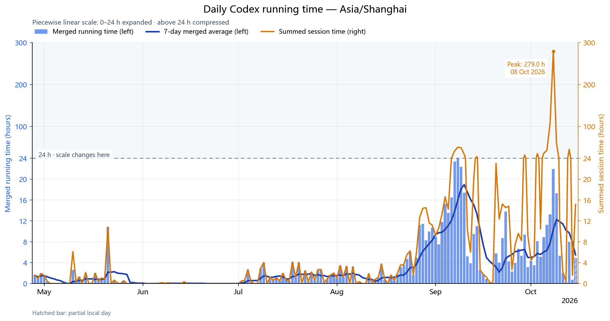

# Codex 本地用量统计

从本机 Codex 日志生成用量图片：token、运行时间、缓存未命中率、模型分布和 API 费用估算。



[查看或下载 MP4 版本](codex_usage_report/02_cumulative_tokens.mp4)。动画按日推进，坐标轴随当时数据缩放，模型颜色始终一致。

<details>
<summary>查看累计用量静态图片</summary>



</details>



图片和动画来自作者的真实本地日志。

统计范围是本机仍保留的日志，不代表账户额度。费用按项目记录的 API 单价估算，不是实际账单。工具在本地运行，无需 API key。

## 使用

Windows 双击 `启动用量统计.cmd`，点击「更新图片」。首次完整读取，之后增量读取；完成后点击「打开图片文件夹」。

图片和 CSV / JSON 数据文件保存在 `codex_usage_report/`。默认读取 `CODEX_HOME` 或用户目录下的 `.codex`，使用上海时区，包含归档记录。需要调整时展开「设置」。

每次更新默认额外生成图 2 的 MP4 动画，从 30 天前推进到今天，模型颜色保持一致。其他图片的动画按需生成，可以直接让 AI agent 按图片编号操作，见 [动画用法](docs/usage.md#动画)。

更多操作见 [使用指南](docs/usage.md)，文件清单见 [输出文件参考](docs/reference.md)。

## 安装

需要 Python 3.10+；GUI 需要 Tkinter。Windows 可双击启动器自动准备项目环境；macOS / Linux 可通过命令行使用。

也可以将仓库地址或本地目录与下面这段话一起交给 AI agent：

```text
请安装这个 Codex 本地用量统计工具。未下载时使用我提供的仓库地址克隆。
阅读 AGENTS.md 和 docs/installation.md，在项目 .venv 中安装依赖并检查 Tkinter。
使用合成 demo 验证，不读取我的真实日志、不自动打开 GUI。
完成后告诉我项目位置、手动启动方式和验证结果。
```

具体步骤见 [安装指南](docs/installation.md)。首次安装依赖需要网络，日常生成图片无需联网。

## 数据

工具只读取会话元数据和用量、活动时间，不使用或导出对话正文，不修改原始日志。完整数据文件可能包含任务标题、工作目录和会话 ID，分享前请检查。

## 文档

- [常见问题](docs/troubleshooting.md)
- [API 费用估算](docs/api-cost.md)
- [开发文档](dev_doc/README.md)
- [参与贡献](CONTRIBUTING.md)
