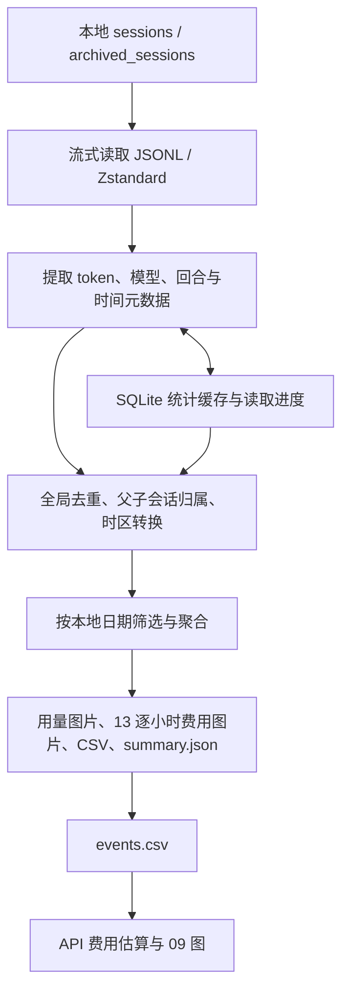

# 架构与数据流

[开发文档入口](README.md) · [统计与数据约定](statistics.md) · [修改与验证](maintenance.md)

## 项目边界

这是直接从源码运行的本地 Python 工具。它把仍保留在本机的 Codex 日志元数据转换为图表与数据表，不依赖模型 API、账户额度接口或数据库服务。原始日志只读；SQLite 是可重建的统计缓存，CSV、JSON 和图片是生成结果。

解析时只保留允许的元数据字段，不使用或导出消息、回答、推理、工具输出正文。任务标题、工作目录、会话 ID 和活动时间仍可能出现在数据文件或缓存中，因此它们属于本地数据，不是适合随代码公开的示例。

## 模块职责

实现放在 `codex_usage/` 包，测试放在 `tests/`；根目录只保留用户入口、文档和项目配置。`codex_usage/__main__.py` 是统一命令路由，按子命令延迟导入模块，因此帮助与环境准备无需先安装绘图依赖。模块间使用相对导入，从项目根目录运行 `python -m codex_usage`。

| 文件 | 职责与主要入口 |
| --- | --- |
| [`codex_usage/charts.py`](../codex_usage/charts.py) | `discover_rollouts` 查找日志；`rollout_lines` 流式读取；`parse_rollout` 提取记录；`collect_usage_data` 汇总与去重；`aggregate_*` 聚合；`export_report` 输出图片与数据文件 |
| [`codex_usage/animations.py`](../codex_usage/animations.py) | `AnimationOptions` 控制编号、日期与帧率；`FrameRenderer` 复用图片函数生成快照；`export_animations` 流式编码 MP4；`animate` 从已有数据文件按需生成动画 |
| [`codex_usage/running_time.py`](../codex_usage/running_time.py) | `RunningIntervalTracker` 重建回合区间；`deduplicate_running_intervals` 去重；`aggregate_daily_running_time` 按本地日期计算合并及相加时长 |
| [`codex_usage/cache.py`](../codex_usage/cache.py) | `UsageCache` 管理 SQLite 事务与记录；`can_resume`、`checkpoint_hashes` 判断能否从旧进度续读 |
| [`codex_usage/cost.py`](../codex_usage/cost.py) | `calculate_event_costs` 按 `OFFICIAL_PRICES` 逐请求计算费用，供 06 任务费用和 13 图复用；独立脚本读取 `events.csv`，生成累计费用与情景结果，并复用图表模块的字体、颜色和保存逻辑 |
| [`codex_usage/thread_metadata.py`](../codex_usage/thread_metadata.py) | 在日期筛选前结合主会话开始时间、目录与本地保存的项目元数据，补齐 06 图的项目名和开始日期；项目名每次刷新，不写入原始日志 |
| [`codex_usage/gui.py`](../codex_usage/gui.py) | `UsageApp` 管理 Tk 控件；`ReportOptions` 保存选项；`generate_reports` 在后台顺序执行两个 CLI |
| [`codex_usage/environment.py`](../codex_usage/environment.py)、[`启动用量统计.cmd`](../启动用量统计.cmd) | 寻找 Python、创建 / 检查项目 `.venv`、安装缺失依赖并启动 GUI |
| [`codex_usage/demo.py`](../codex_usage/demo.py) | 用固定随机种子生成合成元数据，复用正式解析和导出流程生成演示 |
| `tests/test_*.py` | 使用合成日志验证解析、统计、缓存和首次使用入口；`tests/__init__.py` 维持标准 unittest 自动发现 |

运行时间和缓存模块不依赖 GUI。费用脚本复用用量模块的绘图工具，`export_report` 在生成逐小时费用时复用费用计算器；GUI 通过子进程执行 CLI，不在 Tk 主线程导入绘图库或扫描日志。

## 图片与数据文件生成路径

1. 数据根目录取自 `--codex-home`，否则使用 `CODEX_HOME` 或 `~/.codex`。扫描 `sessions`，默认也扫描 `archived_sessions`。
2. 流式读取普通与压缩日志；Python 3.14+ 使用 `compression.zstd`，较早版本使用 `backports.zstd`。压缩读取限制输出块大小并检查帧完整性，不把解压文件写回日志目录。
3. 解析 token 事件、模型与回合状态；运行区间由独立的 tracker 重建。缓存模式以 UTC 保存事件，读取时转换至所选时区。
4. 汇总所有活动文件，去除重复 token / 运行区间，解析父会话关系并重新加载标题。父子关系解析早于日期筛选，以保留没有 token 的中间会话关系。
5. 根据覆盖日期或指定范围生成完整日历日序列，分别聚合用量、缓存比例、小时用量和运行时间。逐小时费用复用 12 图的小时索引，先通过 `calculate_event_costs` 按记录单价和长上下文规则计算每次请求，再按小时与模型求和；无记录单价的模型仅统计未计价请求和用量。
6. `export_report` 写入 9 个 CSV、用量图片、13 逐小时费用图片与 `summary.json`。`recent_hourly_api_cost.csv` 保存逐小时金额和未计价统计；`summary.json` 的 `recent_hourly_api_cost` 保存总额、未计价统计及单价来源、核实日期和规则，`charts` 包含 13 图。费用脚本再独立读取 `events.csv` 输出费用表、JSON 和 09 图。

精确定义与零输入、跨日、重复记录等边界见 [统计与数据约定](statistics.md)。无 token 但有运行区间时，仍会生成运行时间、缓存未命中率和最近七天逐小时图；部分 token 图省略。完全无可用活动时 CLI 返回非零并提示检查目录。

### 动画生成

`export_report` 在静态图片后默认调用 `export_animations` 生成 02 MP4；其他编号仅显式选择时生成。GUI 复用该默认行为，仍在后台子进程运行。独立 `animate` 读取已有 `events.csv`、`summary.json` 和运行区间，不重新扫描日志；只写所选 MP4，并更新汇总的 `animations` 条目。

`FrameRenderer` 提前固定模型、来源和构成配色，按日期截取事件及运行区间，调用现有聚合与绘图函数。绘图函数可接收固定颜色参数；`figure_sink` 用 `ContextVar` 临时接收 `save_figure` 的 Figure，渲染后仍关闭 Figure，既不覆盖静态图片，也不把临时逐帧图片留在目录中。每帧按固定画布尺寸等比缩放并补白，避免任务数、图例或文字变化导致视频尺寸变化。

`imageio-ffmpeg` 提供 FFmpeg 路径，编码子进程通过 stdin 接收 RGB 帧，使用 H.264 / yuv420p 和 MP4 faststart。帧逐个渲染、写入，内存不随动画帧数增加；stderr 写入临时文件，避免管道阻塞。编码完成且退出码为 0 后，才以输出目录内的临时 MP4 替换目标；失败关闭管道、回收编码进程并清理暂存文件，保留旧视频。GUI 取消统计子进程后，编码器的输入管道也随之关闭；与静态输出一样，强制终止可能留下暂存文件。

动画的日期、累计和时区定义见 [动画快照](statistics.md#动画快照)；用户入口与参数集中在 [使用指南](../docs/usage.md#动画)。

## 增量缓存与恢复

默认数据库 `codex_usage_cache.sqlite3` 位于工具目录。`metadata` 保存数据根目录等信息，`logs` 保存文件识别信息、大小 / 修改时间、已读取字节位置、检查点及解析状态；`events` 和 `intervals` 保存绘图所需的 token 记录与运行区间。数据库结构版本由 `CACHE_VERSION` 管理。

缓存不复制原始日志，不保存消息、回答、推理或工具输出正文。时区、日期范围、归档选项和图片格式不使缓存只剩某次筛选结果；每次绘图使用本轮选中的完整数据。13 图直接复用本轮筛选后的事件，独立费用脚本从生成的 `events.csv` 读取。

| 文件状态 | 处理方式 |
| --- | --- |
| 首次扫描或新增日志 | 完整解析该文件并建立状态 |
| 文件大小、修改时间和身份未变化 | 复用缓存，不再打开解析 |
| 普通 JSONL 追加且检查点有效 | 从上次完整行的字节位置继续；末尾半行留待下次 |
| 压缩日志有变化或追加压缩帧 | 整个文件重新解析，不使用解压后的字节位置续读 |
| 文件截断、替换或检测到改写 | 重读该文件 |
| 归档移动 | 文件身份和检查点匹配时复用进度；复制副本仍走去重规则 |
| 日志已删除 | 从对应扫描范围的结果中移除，不能靠缓存保留已丢失的历史 |

未结束回合的活动状态保留到下一次更新；本轮临时结算到最后已知活动，下一轮出现完成标记时由正式区间替代，避免重复累计。压缩 / 未压缩副本以及分叉、迁移副本继续使用全局去重。

写入使用事务，读取失败或中断不提交未成功的进度。损坏或不兼容的缓存保留为 `.invalid-时间戳.bak` 后重建；普通权限错误等不会被当成缓存损坏。完整读取会刷新缓存，切换数据根目录也会重建；长期统计多个根目录时应分别指定 `--cache-file`。

缓存路径不能覆盖 `session_index.jsonl`，也不能放进原始 `sessions` / `archived_sessions` 目录。需要修改持久化格式时，同时检查版本兼容、旧缓存备份、事务回滚与重复事件处理。

## 启动与 GUI

Windows 启动器优先使用工具目录的 `.venv`，其次尝试 `py -3`，最后查找 PATH 中的 Python。`codex_usage/environment.py` 用标准库准备环境，检查 Python 版本、依赖导入和最低版本、时区数据；启动 GUI 时还检查 Tkinter。环境不完整时在本项目 `.venv` 中安装 `requirements.txt`，正常时跳过安装。`--check` 只检查、不安装、不启动。

GUI 默认使用上海时区、包含归档并统计全部日期。`codex_usage_settings.json` 保存用户上次选择的数据目录、IANA 时区和归档选项；格式无效时恢复默认值。CLI 保留独立参数，包括日期范围、输出目录、格式等；其默认时区 `local` 是系统当前 UTC 偏移，跨夏令时日期应指定 IANA 时区。

GUI 使用紧凑的原生控件布局，保留「更新图片」「打开图片文件夹」、一行状态，以及设置、日志和帮助入口。主按钮默认调用增量模式，缓存缺失时自动完整读取。数据目录、时区、归档选项及「重新完整读取」放在可折叠设置中；校验失败时自动展开设置。

`generate_reports` 在线程中顺序启动用量与费用子进程，把输出写到 `gui_run.log`，通过队列发送 `status` / `done` / `cancelled` / `error`。Tk 主线程通过 `after` 消费队列，更新状态和控件。

更新时禁用设置和更新按钮，图表统一通过结果目录查看。取消通过 `threading.Event` 通知后台，终止当前子进程，超时后强制结束；关闭窗口保留确认停止的行为。费用步骤失败会区分“用量已完成”的情况。输出文件逐个写入，整次运行不具备整体事务：失败或取消可能留下部分新结果，下一次生成重建它们。

## 输出与绘图约定

复用 `configure_matplotlib`、`setup_date_axis`、`format_tokens` 和 `save_figure`。`save_figure` 先在**输出目录内**渲染临时文件，再替换目标并清理临时文件，以保持 Windows 查看器的读取权限兼容。

GUI 的结果路径锚定工具目录；CLI 默认输出相对当前工作目录。CSV 使用 UTF-8 BOM，JSON 使用 UTF-8；导出日期保留时区，无定义的 JSON 比例使用 `null`。具体文件名、编号和字段见 [输出文件参考](../docs/reference.md)。

移动代码目录不改变本地数据的位置：GUI、环境准备和默认缓存都从包目录向上定位项目根目录，继续使用原来的 `.venv`、`codex_usage_report/`、`codex_usage_cache.sqlite3` 与设置文件。

README 直接引用输出目录中的 `02_cumulative_tokens.png` 和 `10_daily_running_time.png`，不另建预览图片。GitHub 保留两张图片的现有版本；本地生成流程继续更新它们，后续修改按 [贡献说明](../CONTRIBUTING.md#提交内容) 排除提交与上传。其他生成文件仍由 `.gitignore` 排除。
